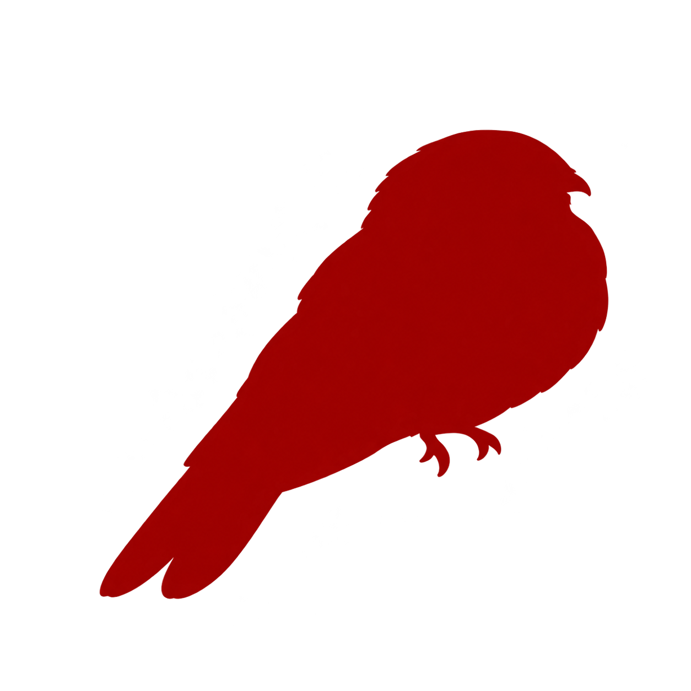
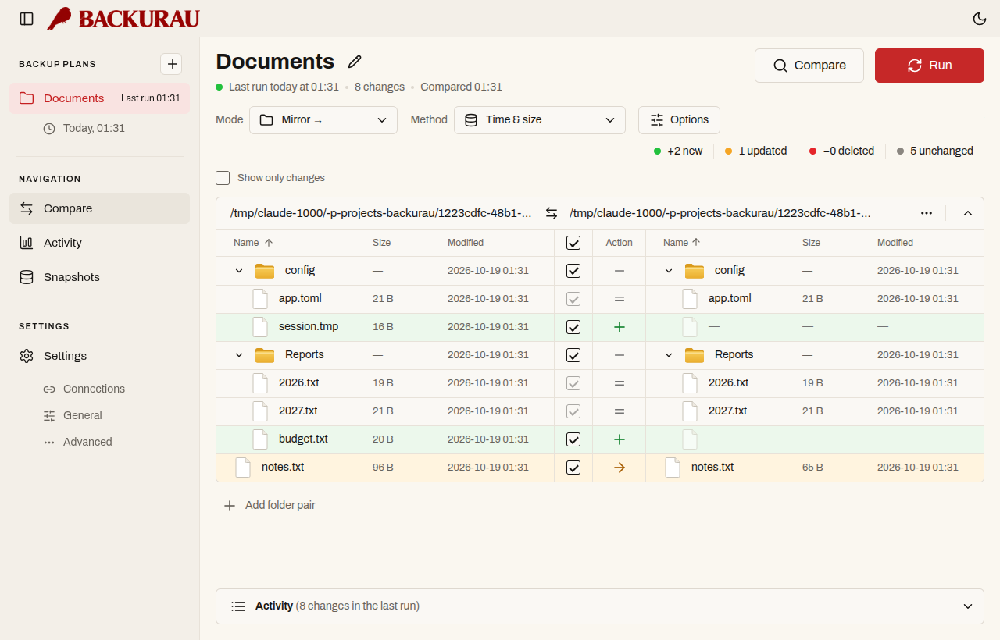
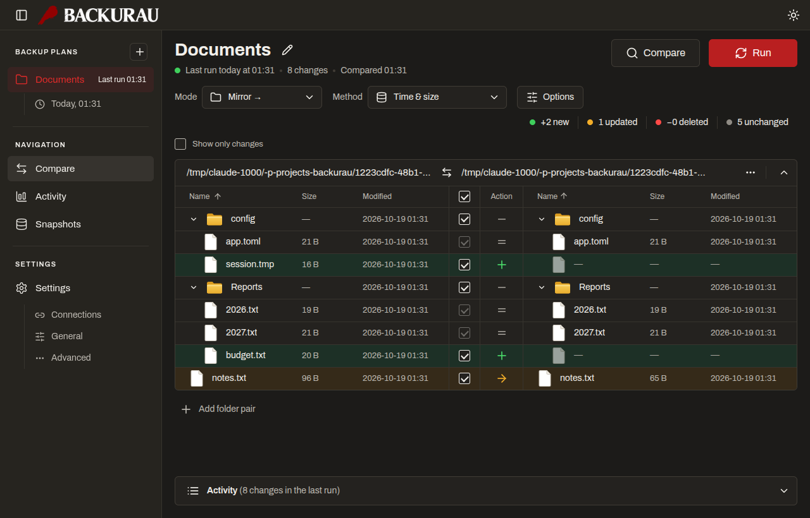
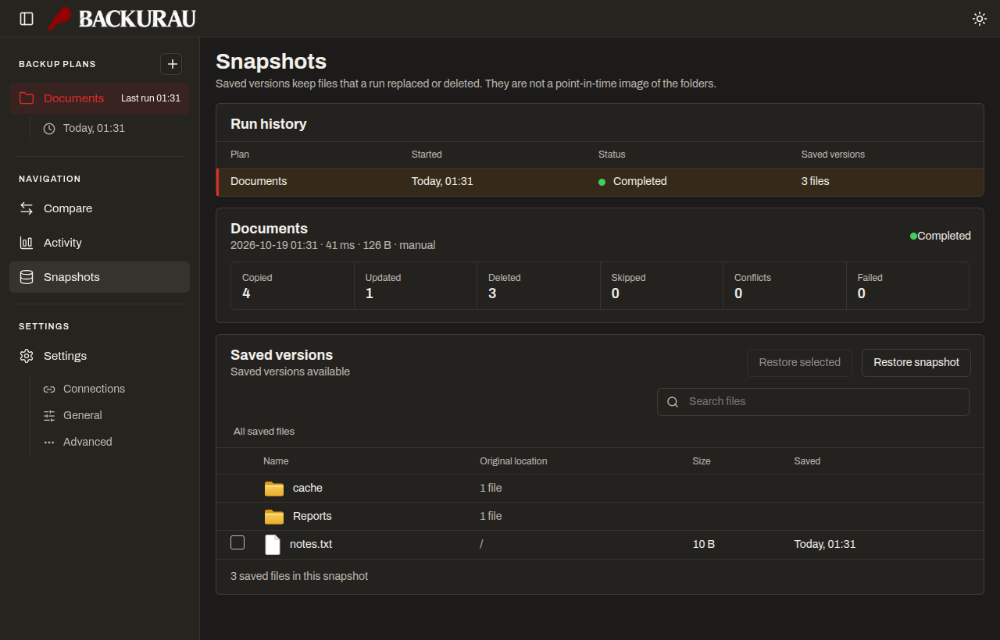
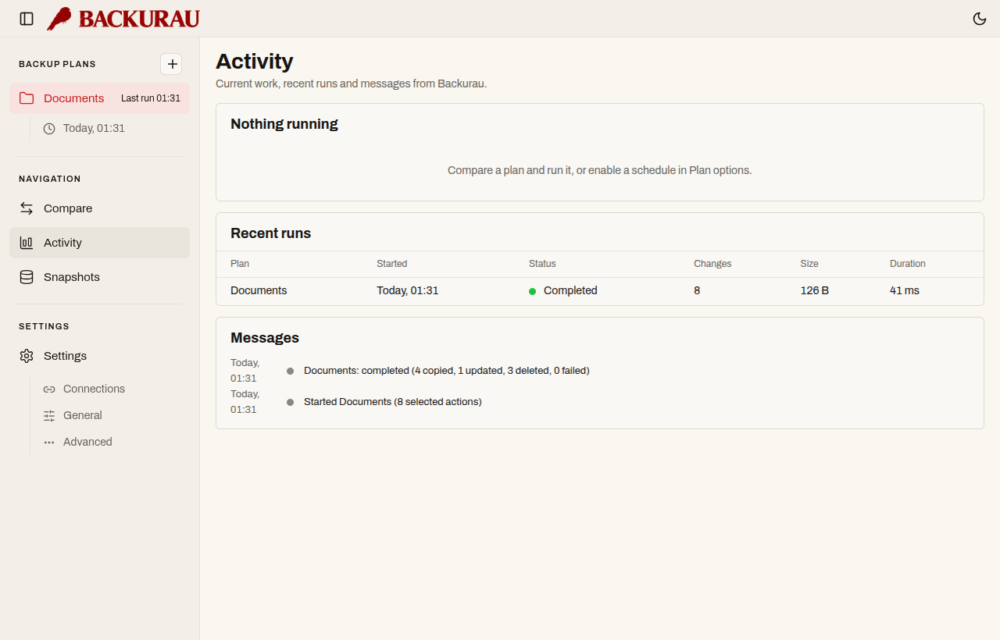
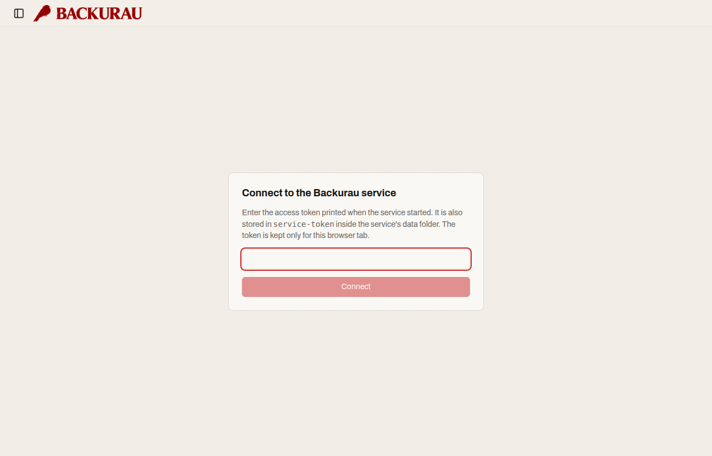
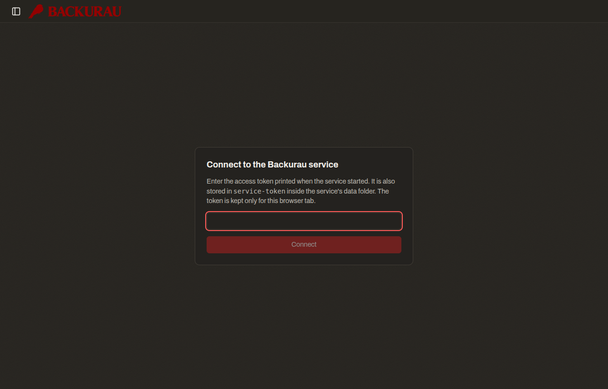
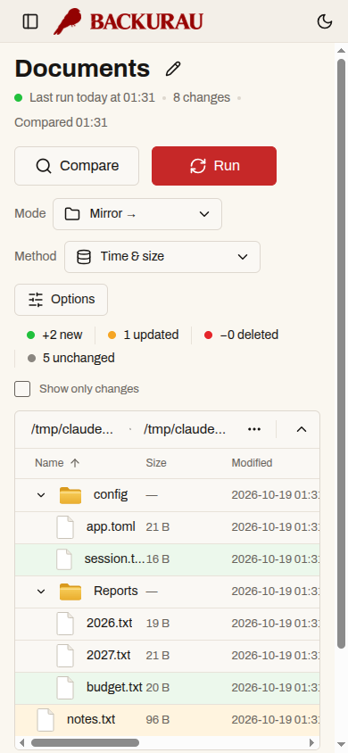
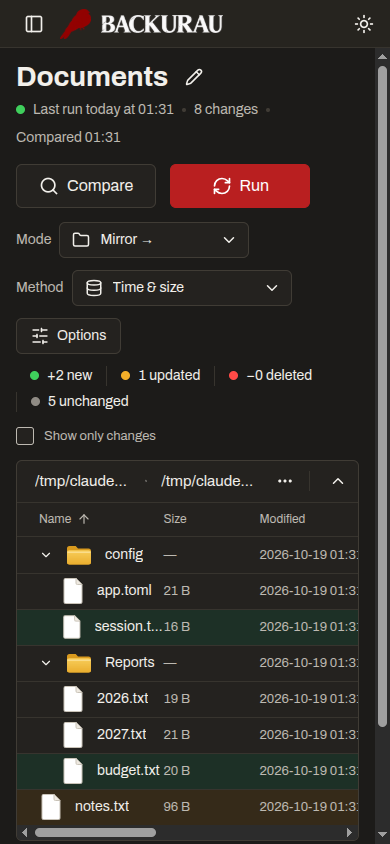

<p align="center"></p>
<h1 align="center">Backurau</h1>

Backups for your own machine, in a desktop app inspired by the art of _Bacurau_ (2019):
scorched earth, dust, aged paper and blood red. A shared Rust engine (`core/`) powers a Tauri v2
desktop app and an authenticated web service (`server/`); the interface is React + Vite.

Everything on screen comes from the engine. There is no demo data, and plans only ever touch folders you add.

## What it does

- **Plans** with one or more folder pairs, modes mirror / update / two-way / custom, time-and-size or content comparison, include/exclude globs and `regex:` rules.
- **Compare, then run**: review the differences, pick what to apply, resolve conflicts (keep source, destination, both, skip). Runs revalidate the preview first.
- **Saved versions**: files a run replaced or deleted are kept and can be restored from Snapshots. This is not a point-in-time image of the folders.
- **Providers**: local and mounted folders, optional rsync engine, and rclone for SFTP, WebDAV, S3, Google Drive and OneDrive. Secrets live in the OS credential store only.
- **Automation**: schedules, on-change and on-available triggers run while the app or the service is running.
- Light and dark themes; web service on loopback with token authentication.

Not verified on this Linux host: Windows and macOS builds, and live cloud-provider sign-in. rclone-based connections need rclone installed.

## Screenshots

Desktop app (`docs/screens/app/`), light and dark:

| Compare | Compare, dark |
| --- | --- |
|  |  |

| Snapshots, dark | Activity, light |
| --- | --- |
|  |  |

Web service (`docs/screens/web/`): token screen, then the same Compare view on a phone-width screen.

| Token screen, light | Token screen, dark |
| --- | --- |
|  |  |

| Compare on a phone, light | Compare on a phone, dark |
| --- | --- |
|  |  |

The screenshots were taken in Chrome from the same React UI the desktop window loads, using temporary fixture folders. The native Tauri window itself was not captured.

## Run

```bash
cd tauri-app
npm install
npm run tauri dev        # native window, real data
npm run tauri build      # .deb / .rpm / AppImage in src-tauri/target/release/bundle/
```

System libraries and troubleshooting: `tauri-app/README.md` (`./check-deps.sh` lists what is missing).

Optional tools: `rsync` (local engine) and `rclone` (remote connections).

Web service: `cargo run --manifest-path server/Cargo.toml` (or `docker compose up -d --build server`); it prints an access token and stores it in `<data>/service-token`.

Run it in the background on Linux with `scripts/service-linux.sh install` (systemd user unit; `uninstall` removes it). Provider details and platform limits: `docs/PROVIDERS.md`.

## Test

```bash
cargo test --manifest-path core/Cargo.toml
cd tauri-app && npm test && npm run build
cargo build --manifest-path server/Cargo.toml && node scripts/verify-integration.mjs
```

CI (`.github/workflows/ci.yml`) runs the same steps on Linux, Windows and macOS and builds the desktop bundles. Results appear only once CI has run on GitHub.

## Layout

```
backurau/
├── core/        shared Rust engine (plans, runs, providers, credentials)
├── server/      axum web adapter, serves the built UI
├── docs/        PROVIDERS.md
├── scripts/     verify-integration.mjs, service-linux.sh, mkcert-local.sh
├── .github/workflows/  CI

└── tauri-app/
    ├── src/         React UI
    ├── ui/          build output (generated)
    └── src-tauri/   Tauri adapter
```
